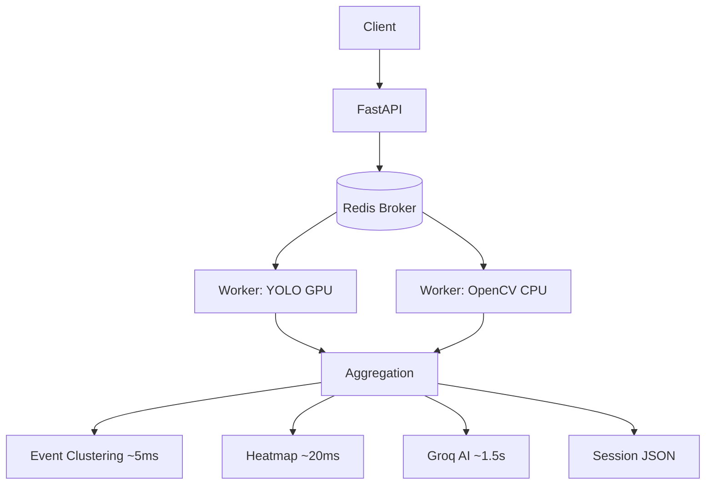

# 🔍 Drishti — Complete Project Deep Dive

> **DI2_33_Genesis** · DEXIT Hackathon Problem Statement #2  
> *AI-powered offline exam-hall surveillance & cheating detection system*

---

## 1. What is Drishti?

**Drishti** (Sanskrit for *vision*) is an **offline video analysis system** that scans recorded examination-hall CCTV footage to automatically detect and flag cheating incidents. An investigator uploads a recorded video; the system runs computer vision + AI pipelines on it in the background; the investigator gets back a rich, interactive forensic dashboard showing every suspicious event with timestamps, confidence scores, motion heatmaps, and an AI-generated risk summary.

The name **DI2_33_Genesis** places this as Team 33's submission in the DEXIT Hackathon (DI2 track).

---

## 2. High-Level System Architecture

```
┌─────────────────────────────────────────────────────────────────┐
│                       BROWSER (React + Vite)                    │
│   Login → Dashboard → Upload → Processing → Session Review      │
│                        Polling /api/task/{id}                   │
└───────────────────────────┬─────────────────────────────────────┘
                            │ HTTP REST (localhost:8000)
┌───────────────────────────▼─────────────────────────────────────┐
│                    FastAPI  (main.py  v3.0.0)                   │
│  POST /api/analyze → saves video → enqueues Celery task         │
│  GET  /api/task/{id} → polls Redis for worker progress          │
│  GET  /api/session/{id}, /api/sessions                          │
│  GET  /api/video/{id}/original|annotated                        │
│  GET  /api/heatmap/{id}, /api/detections/{id}, /api/motion/{id} │
└───────────────────────────┬─────────────────────────────────────┘
                            │ Celery task dispatch
┌───────────────────────────▼─────────────────────────────────────┐
│                  Redis 7.2 (Broker + Result Backend)            │
│                  docker container: drishti_redis                │
└───────────────────────────┬─────────────────────────────────────┘
                            │ task pickup
┌───────────────────────────▼─────────────────────────────────────┐
│               Celery Worker  (tasks.analyze_video_task)         │
│  ┌──────────────────────────────────────────────────────────┐   │
│  │  ThreadPoolExecutor (max_workers=2)                      │   │
│  │  ├── Thread A: yolo_service.process_video()  [GPU/CPU]  │   │
│  │  └── Thread B: motion_service.process_motion()  [CPU]   │   │
│  └────────────────────┬─────────────────────────────────────┘   │
│                        │ both results collected                  │
│  ├── event_builder.build_events()        (~5 ms)                │
│  ├── heatmap_service.generate_heatmap()  (~20 ms)               │
│  ├── groq_service.generate_summary()     (~1.5 s, network)      │
│  └── Write JSON session file to data/sessions/{id}.json         │
└─────────────────────────────────────────────────────────────────┘
```

---

## 3. Technology Stack

| Layer | Technology | Why |
|---|---|---|
| **API server** | FastAPI (Python) | Async, fast, auto-docs |
| **Task queue** | Celery ≥ 5.3.6 | Non-blocking background workers |
| **Broker / cache** | Redis 7.2 (Docker) | Task routing + result storage |
| **Object detection** | YOLOv11s (Ultralytics) | GPU-accelerated cell phone detection |
| **Motion analysis** | OpenCV (cv2) | Frame differencing, morphology |
| **Heatmap** | OpenCV + NumPy | Pixel-level motion accumulation → JET colormap |
| **AI narrative** | Groq API → LLaMA 3.1 8B Instant | Sub-2s exam event summaries |
| **Container** | Docker Compose | Reproducible Redis + worker setup |
| **Frontend** | React 18 + Vite | SPA with fast HMR dev server |
| **Styling** | TailwindCSS | Utility-first dark-mode UI |
| **Routing** | React Router v6 | Client-side SPA routing |

---

## 4. Backend Deep Dive

### 4.1 `main.py` — FastAPI Server

The nerve centre. Exposes 9 REST endpoints:

| Endpoint | Method | Role |
|---|---|---|
| `/` | GET | Health check |
| `/api/analyze` | POST | Upload video → enqueue Celery task → return `task_id` immediately |
| `/api/analyze/sync` | POST | Synchronous fallback (debug/dev only) |
| `/api/task/{task_id}` | GET | Poll Celery worker progress; returns `PENDING → PROCESSING (15%–90%) → SUCCESS` |
| `/api/session/{video_id}` | GET | Return full session JSON |
| `/api/sessions` | GET | List all completed sessions |
| `/api/video/{video_id}/original` | GET | Stream raw uploaded video |
| `/api/video/{video_id}/annotated` | GET | Stream YOLO-annotated output video |
| `/api/heatmap/{video_id}` | GET | Serve PNG heatmap image |
| `/api/detections/{video_id}` | GET | Raw per-frame YOLO JSON |
| `/api/motion/{video_id}` | GET | Raw per-frame motion JSON |

**Key design decision:** `POST /api/analyze` saves the video to disk and immediately dispatches `analyze_video_task.delay(...)` to Redis, returning the `task_id` in **< 1 second**. The frontend never blocks waiting for GPU inference.

**CORS** is configured explicitly for Vite dev servers on ports 5173/5174.

**File storage layout:**
```
backend/data/
├── original/      ← raw uploaded videos
├── annotated/     ← YOLO-drawn MP4 outputs
├── results/       ← per-frame YOLO detections JSON
├── motions/       ← per-frame motion JSON
├── sessions/      ← complete session JSON (single source of truth)
└── heatmaps/      ← thermal overlay PNGs
```

---

### 4.2 `celery_app.py` — Celery Configuration

```python
REDIS_URL = os.getenv("REDIS_URL", "redis://localhost:6379/0")

celery_app = Celery("drishti_worker", broker=REDIS_URL, backend=REDIS_URL, include=["tasks"])

celery_app.conf.update(
    result_expires=86400,          # store results 24 hours
    task_track_started=True,       # STARTED state is visible
    task_acks_late=True,           # don't delete task until fully done
    worker_prefetch_multiplier=1,  # 1 heavy video job at a time per worker
)
```

**`task_acks_late=True`** is critical — if the worker crashes mid-inference, the task is re-queued automatically rather than lost.

---

### 4.3 `tasks.py` — The Core Pipeline

This is where the magic happens. The Celery task `analyze_video_task` orchestrates the entire analysis pipeline:

#### Stage 1: Parallel Heavy Compute (15% → 70%)

```python
with ThreadPoolExecutor(max_workers=2) as executor:
    future_yolo   = executor.submit(process_video, ...)   # GPU
    future_motion = executor.submit(process_motion, ...)  # CPU
    yolo_result   = future_yolo.result()
    motion_result = future_motion.result()
```

YOLO and OpenCV run **simultaneously** using Python threads. Because YOLO runs on the GPU and motion analysis is purely CPU-bound, they don't compete for the same resource — genuine parallel speedup.

#### Stage 2: Downstream Aggregation (80%)
- `build_events()` — clusters detections into events
- `generate_heatmap()` — builds thermal PNG

#### Stage 3: AI Summary (90%)
- `generate_summary()` → Groq LLaMA 3.1 8B

#### Stage 4: Session Persistence (100%)
Writes a single master JSON file to `data/sessions/{video_id}.json`:
```json
{
  "session": { "id", "hallName", "examName", "riskLevel", "aiSummary", ... },
  "events": [...],
  "motion": {...}
}
```

**Live progress updates** are pushed back to Redis throughout via `self.update_state()`, so the frontend polling at 1s intervals sees real-time percentage updates.

---

### 4.4 `yolo_service.py` — Object Detection

- **Model:** `yolo11s.pt` (YOLOv11 small, ~19 MB, pre-trained on COCO)
- **Target class:** `cell_phone` (COCO class ID 67)
- **Confidence threshold:** 0.25 (25%)
- **Device:** auto-detects NVIDIA GPU (`torch.cuda.is_available()`), falls back to CPU
- **Frame stride:** configurable — stride=1 means every frame, stride=2 halves processing time
- **Output:** annotated MP4 (with bounding boxes drawn via `result.plot()`) + JSON of all detections

Each detection record:
```json
{
  "frame": 142,
  "timestamp": 4.733,
  "timestamp_formatted": "00:04.73",
  "class_name": "cell phone",
  "confidence": 0.7812,
  "bbox": { "x1": 340.2, "y1": 210.5, "x2": 395.1, "y2": 280.3 }
}
```

A `progress_callback` is invoked every 15 frames, sending live updates back through Celery to Redis.

---

### 4.5 `motion_service.py` — Motion Analysis

A multi-stage **frame-differencing** pipeline:

```
Frame N-1 ──┐
             ├─► Grayscale ──► GaussianBlur(21×21) ──► absdiff
Frame N ────┘                                             │
                                                          ▼
                                              Threshold(38) ──► Binary Mask
                                                          │
                                              Morphological Open ──► Dilate(2×)
                                                          │
                                              findContours ──► filter(area > 850)
                                                          │
                                              Bounding rects ──► motion_score
```

**Key parameters:**
| Parameter | Value | Effect |
|---|---|---|
| `DIFF_THRESHOLD` | 38 | Pixel brightness change needed to be "motion" |
| `MIN_CONTOUR_AREA` | 850 px² | Ignores dust/sensor noise |
| `BLUR_SIZE` | 21 | Pre-blur to reduce noise |
| `MIN_EVENT_FRAMES` | 3 | Requires ≥3 consecutive motion frames per event |
| `MAX_EVENT_GAP` | 5 frames | Gap before splitting into a new event |

`motion_score` = (total moving pixels) / (frame area) — a normalised 0–1 score.

Motion frames are clustered into **motion events** using gap-based temporal grouping, each event getting a consolidated bounding box and `max_motion_score`.

---

### 4.6 `event_builder.py` — YOLO Detection Clustering

Converts raw per-frame YOLO detections into **frontend-ready event objects**:

1. **Sort** all detections by timestamp
2. **Gap-based clustering** — detections within `GAP_THRESHOLD = 0.5s` of each other → same cluster
3. **Per-cluster aggregation:**
   - `avg_confidence`, `peak_confidence`, `duration`
   - ROI taken from the **peak-confidence** frame
4. **Auto-escalation rule:**
   - `avg_confidence >= 0.60` → `"escalated"` (confident detection)
   - `duration >= 1.5s` → `"escalated"` (sustained usage)
   - Otherwise → `"pending"` (brief/uncertain)
5. **Human-readable explanation** string generated for each event

Event output shape:
```json
{
  "id": "evt_a3f2b1c4",
  "type": "phone_use",
  "timestampStart": 12.45,
  "timestampEnd": 15.20,
  "confidence": 0.741,
  "objectsDetected": ["mobile_phone"],
  "roi": { "x": 340, "y": 210, "w": 55, "h": 70 },
  "reviewStatus": "escalated",
  "explanation": "Cell Phone detected across 8 consecutive frames (12.45s – 15.20s, 2.75s duration). Peak model confidence: 78%. HIGH RISK. Sustained detection — candidate likely actively using device."
}
```

---

### 4.7 `heatmap_service.py` — Spatial Motion Heatmap

Generates a **thermal overlay PNG** that visually shows *where* in the exam hall motion occurs most:

1. Opens the original video and accumulates pixel-level frame differences into a float32 `motion_canvas`
2. Normalizes to 0–255
3. Applies Gaussian smoothing (kernel ≈ 3.5% of frame width) for organic thermal spread
4. Maps to **OpenCV JET colormap** (blue=calm → cyan → green → yellow → red=hot)
5. **Blends 48% real frame + 52% thermal map**
6. Draws a bottom-left legend bar ("Low motion → High motion")

The reference frame is taken at the 25% mark of the video (typically the clearest static classroom shot).

---

### 4.8 `groq_service.py` — LLaMA AI Summary

Calls **Groq's LLaMA 3.1 8B Instant** model to generate a structured JSON narrative:

**System prompt:** "You are an AI system that analyses exam-hall surveillance video... Respond ONLY with valid JSON."

**Input prompt** includes:
- Hall name, exam name, date, camera ID
- Total detections, total events, escalated event count
- Average confidence percentage
- Top event details

**Output:**
```json
{
  "summary": "During the Semester 5 DBMS exam in Hall A, YOLO11s detected 3 suspicious events...",
  "risk_level": "HIGH",
  "recommended_action": "Immediately review the 2 escalated events at timestamps 4:12 and 8:37."
}
```

**Fallback:** If Groq is unavailable, a deterministic rule-based summary is generated locally — the system never crashes due to a missing API key.

---

### 4.9 Infrastructure

**`docker-compose.yml`** runs two services:
- **`drishti_redis`** — Redis 7.2 Alpine on port 6379, with a persistent `redis_data` volume
- **`drishti_celery_worker_1`** — built from `Dockerfile.worker`, mounts `backend/data` and `backend/yolo11s.pt`, receives `GROQ_API_KEY` env var

**`run_worker.bat`** — Windows-friendly shortcut to start the Celery worker locally:
```bat
celery -A celery_app.celery_app worker --loglevel=info --pool=solo
```
(`--pool=solo` is required on Windows because Python's `fork()` is not supported — Celery uses thread-based concurrency instead.)

---

## 5. Frontend Deep Dive

### 5.1 Tech Stack
- **React 18** + **Vite** (dev server on port 5173/5174)
- **TailwindCSS** — dark-first, custom design tokens
- **React Router v6** — client-side SPA routing
- **Framer Motion** — subtle forensic-grade transitions

### 5.2 Application Shell & Routing

```
/login                → Login.jsx            (public)
/dashboard            → Dashboard.jsx        (protected)
/upload               → Upload.jsx           (protected)
/evaluations          → Evaluations.jsx      (protected)
/session/:id          → SessionReview.jsx    (protected)
/session/:id/export   → Export.jsx           (protected)
/prototype            → Prototype.jsx        (dev sandbox)
```

All protected routes are wrapped in `ProtectedRoute` + `AppShell` (sidebar + topnav layout).

### 5.3 Pages

| Page | Responsibility |
|---|---|
| **Login** | Minimal auth screen, product name/tagline |
| **Dashboard** | Lists all sessions (live + mock), status pills, quick stats, "Upload Recording" CTA |
| **Upload** | Drag-and-drop video picker, metadata fields (hall, exam name, date, camera ID), dispatches upload |
| **Processing** | Live progress bar polling `/api/task/{id}` every second, stage labels |
| **Evaluations** | Combined processing + session list view |
| **SessionReview** | Core screen — video player, activity timeline, event list, ROI overlay, heatmap toggle |
| **Export** | Aggregate stats, PDF/CSV export stub |
| **Prototype** | Dev sandbox for component testing |

### 5.4 API Layer (`src/api/index.js`)

The API layer implements a **3-tier data fallback**:
1. **sessionStorage** — data from the most recent upload, fastest
2. **localStorage + backend fetch** — persisted live sessions, fetched fresh
3. **Mock data** — hardcoded demo sessions/events for offline/prototype use

#### Upload & Polling Flow:
```
uploadAndAnalyze(file, metadata, onProgress)
  │
  ├─ XHR POST /api/analyze
  │   └─ Upload progress: 0-10% via xhr.upload.onprogress
  │
  ├─ Returns { task_id, video_id }
  │
  └─ Polls GET /api/task/{task_id} every 1000ms (max 10 min)
      ├─ PENDING     → 0%
      ├─ PROCESSING  → 15%–90% (live from worker)
      ├─ SUCCESS     → 100% → resolve(task)
      └─ FAILURE     → reject(error)
```

The active task is also persisted to `localStorage` (`drishti_active_task`) so if the user navigates away and comes back, the polling can resume.

### 5.5 Component Architecture

```
src/components/
├── layout/
│   ├── AppShell.jsx        ← sidebar + top nav wrapper
│   └── ProtectedRoute.jsx  ← auth guard
├── events/                 ← EventCard, EventList, ConfidenceBadge
├── forensics/              ← motion analysis visualizations
├── report/                 ← session summary components
├── ui/                     ← shared primitives (StatusPill, etc.)
├── upload/                 ← UploadDropzone
└── video/                  ← VideoPlayer + ROI overlay canvas
```

### 5.6 Visual Design Philosophy

From the SRS document — **"investigation console"** feel:
- **Dark-first** — `#0B0C0E`–`#121316` backgrounds
- **One accent color** — muted electric blue or amber, used sparingly
- **Typography** — Inter/Geist, monospace timestamps
- **Glassmorphism** — subtle blur only on top nav
- **Micro-animations** — 150–250ms fade/slide only (no bouncy easing)
- **Lucide icons** — thin-stroke, consistent set

---

## 6. Full Data Flow — End to End

```
1. Investigator opens Upload page, drags a video file
2. Fills metadata: Hall = "A101", Exam = "DBMS Sem5", Date, Camera = "CAM-01"
3. Clicks "Analyze"

4. XHR POST /api/analyze (multipart/form-data)
   → FastAPI saves video to data/original/{uuid}.mp4
   → analyze_video_task.delay(...) pushed to Redis
   → Returns { task_id: "abc-123", video_id: "uuid" } in < 1s

5. Frontend stores active task in localStorage
   Frontend begins polling GET /api/task/abc-123 every 1000ms

6. Celery worker picks up task from Redis queue
   → Updates state: "PROCESSING 15% — Starting Parallel Analysis"
   → ThreadPoolExecutor spawns 2 threads:
       Thread A: YOLO11s runs on every frame (GPU accelerated)
                 → writes annotated MP4 to data/annotated/{uuid}_annotated.mp4
                 → reports frame progress: 15%...25%...45%...70%
       Thread B: OpenCV motion analysis runs concurrently (CPU)
                 → detects motion regions per frame
                 → clusters into motion events
   → Both futures resolve

   → Updates state: "PROCESSING 80% — Clustering Events & Heatmap"
   → event_builder.build_events() → clusters YOLO detections → event list
   → generate_heatmap() → accumulates pixel motion → JET PNG → saves

   → Updates state: "PROCESSING 90% — Generating Groq AI Summary"
   → Groq API call → LLaMA 3.1 8B → { summary, risk_level, recommended_action }

   → Builds master session object
   → Writes data/sessions/{uuid}.json
   → Returns SUCCESS to Redis

7. Frontend poll sees state=SUCCESS
   → onProgress(100, "Analysis Completed")
   → Stores session data in sessionStorage + localStorage
   → Navigates to /session/{uuid}

8. SessionReview page loads:
   → Video player (original or annotated)
   → Activity timeline with event markers
   → Event list panel (filterable by risk/status)
   → Click an event → video seeks to timestamp, ROI box drawn on canvas
   → Heatmap toggle → fetches /api/heatmap/{uuid}
   → AI Summary card at top
   → Investigator marks events: Reviewed / Dismissed / Escalated

9. Export page → aggregated stats → PDF/CSV generation
```

---

## 7. Scalability Architecture

The implementation plan describes the intended scaling path:



**Scale-out path:** Multiple Celery worker containers can be spun up with `docker-compose --scale celery_worker=N`. Redis distributes tasks across all workers automatically.

**Current bottleneck:** YOLOv11s inference time (depends on GPU). A stride=2 can halve processing time at slight accuracy cost.

---

## 8. Key Engineering Decisions

| Decision | Rationale |
|---|---|
| **Async task queue (Celery + Redis)** | YOLO inference takes 30s–5min per video — blocking the HTTP server is unacceptable |
| **Parallel YOLO + OpenCV via ThreadPoolExecutor** | GPU is idle during CPU-bound motion analysis; parallelism cuts total time significantly |
| **`task_acks_late=True`** | Worker crash safety — task is re-queued if the worker dies mid-inference |
| **`worker_prefetch_multiplier=1`** | Prevents one worker from hogging 2+ video jobs simultaneously |
| **3-tier data fallback in API layer** | Graceful degradation when backend is offline; demo works without any API connection |
| **Active task in localStorage** | Survives page navigation during the analysis wait |
| **Groq fallback** | System never fails due to missing API key — rule-based summary is generated instead |
| **JET colormap + 48/52 blend** | Thermal heatmap remains readable against the actual classroom background |
| **Windows `--pool=solo`** | Python fork() is unavailable on Windows; solo pool uses thread-based concurrency |

---

## 9. File Reference Map

| File | Role |
|---|---|
| [`backend/main.py`](file:///c:/Users/pytho/Desktop/RESUME%20PROJECTS/scaling-drishti/DI2_33_Genesis/backend/main.py) | FastAPI server, all REST endpoints |
| [`backend/celery_app.py`](file:///c:/Users/pytho/Desktop/RESUME PROJECTS/scaling-drishti/DI2_33_Genesis/backend/celery_app.py) | Celery instance + Redis config |
| [`backend/tasks.py`](file:///c:/Users/pytho/Desktop/RESUME%20PROJECTS/scaling-drishti/DI2_33_Genesis/backend/tasks.py) | Main pipeline Celery task |
| [`backend/yolo_service.py`](file:///c:/Users/pytho/Desktop/RESUME%20PROJECTS/scaling-drishti/DI2_33_Genesis/backend/yolo_service.py) | YOLO11s inference + annotated video |
| [`backend/motion_service.py`](file:///c:/Users/pytho/Desktop/RESUME%20PROJECTS/scaling-drishti/DI2_33_Genesis/backend/motion_service.py) | OpenCV frame differencing + motion events |
| [`backend/event_builder.py`](file:///c:/Users/pytho/Desktop/RESUME%20PROJECTS/scaling-drishti/DI2_33_Genesis/backend/event_builder.py) | YOLO detection clustering → frontend events |
| [`backend/heatmap_service.py`](file:///c:/Users/pytho/Desktop/RESUME%20PROJECTS/scaling-drishti/DI2_33_Genesis/backend/heatmap_service.py) | Thermal motion heatmap PNG generation |
| [`backend/groq_service.py`](file:///c:/Users/pytho/Desktop/RESUME%20PROJECTS/scaling-drishti/DI2_33_Genesis/backend/groq_service.py) | LLaMA 3.1 AI summary via Groq API |
| [`docker-compose.yml`](file:///c:/Users/pytho/Desktop/RESUME%20PROJECTS/scaling-drishti/DI2_33_Genesis/docker-compose.yml) | Redis + Celery worker containers |
| [`frontend/drishti-ui/src/api/index.js`](file:///c:/Users/pytho/Desktop/RESUME%20PROJECTS/scaling-drishti/DI2_33_Genesis/frontend/drishti-ui/src/api/index.js) | API layer with polling + 3-tier fallback |
| [`frontend/drishti-ui/src/App.jsx`](file:///c:/Users/pytho/Desktop/RESUME%20PROJECTS/scaling-drishti/DI2_33_Genesis/frontend/drishti-ui/src/App.jsx) | React Router route definitions |
| [`opencv_pipeline_diagram.md`](file:///c:/Users/pytho/Desktop/RESUME%20PROJECTS/scaling-drishti/DI2_33_Genesis/opencv_pipeline_diagram.md) | CV pipeline documentation |
| [`implementation_plan - scalability`](file:///c:/Users/pytho/Desktop/RESUME%20PROJECTS/scaling-drishti/DI2_33_Genesis/implementation_plan%20-%20scalability) | Distributed architecture plan |
| [`frontend/PS2_Frontend_SRS.md`](file:///c:/Users/pytho/Desktop/RESUME%20PROJECTS/scaling-drishti/DI2_33_Genesis/frontend/PS2_Frontend_SRS.md) | Frontend requirements specification |
