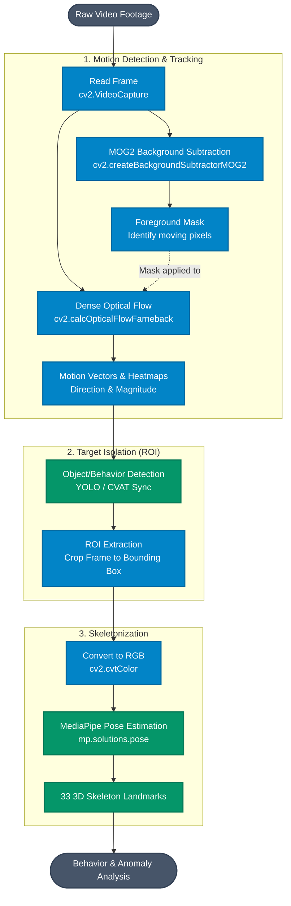

# Computer Vision Processing Flow

This diagram illustrates the sequential computer vision pipeline used to analyze examination footage, focusing heavily on motion analysis and pose extraction.

### Flow Breakdown:
1. **MOG2 Background Subtraction:** The frame first passes through the MOG2 algorithm. It learns the static background of the examination hall (desks, walls) and produces a mask that highlights only the moving foreground elements (students, papers, phones).
2. **Optical Flow (Farneback):** Dense optical flow is calculated to understand the direction and magnitude of the motion (e.g., distinguishing between a student writing normally vs. rapidly turning their head). The MOG2 mask is often used to filter out noise, so optical flow is only calculated on moving subjects.
3. **ROI Extraction:** Before generating the skeleton, the region of interest (ROI) is isolated using a bounding box to focus the analysis strictly on the candidate, ignoring the rest of the room.
4. **MediaPipe Pose:** The cropped, RGB-converted ROI is passed to MediaPipe, which extracts the 33 skeletal landmarks. Because the image is already filtered and cropped by the earlier pipeline steps, MediaPipe runs highly efficiently and accurately on just the target.
